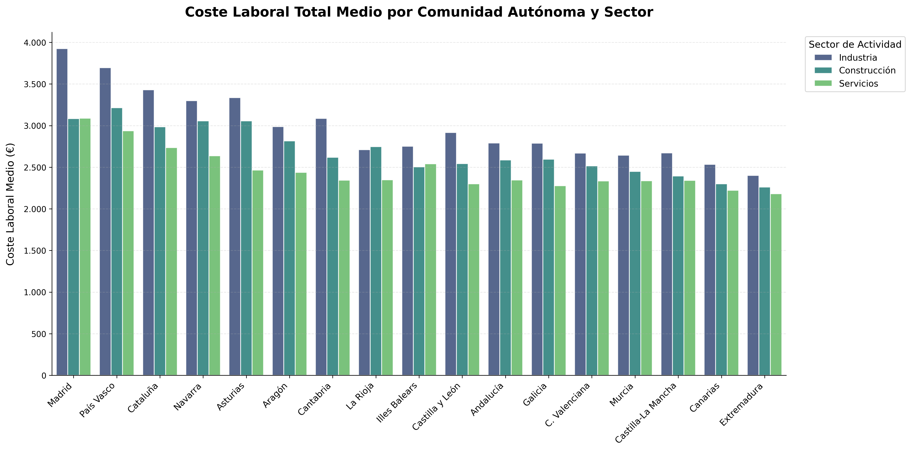
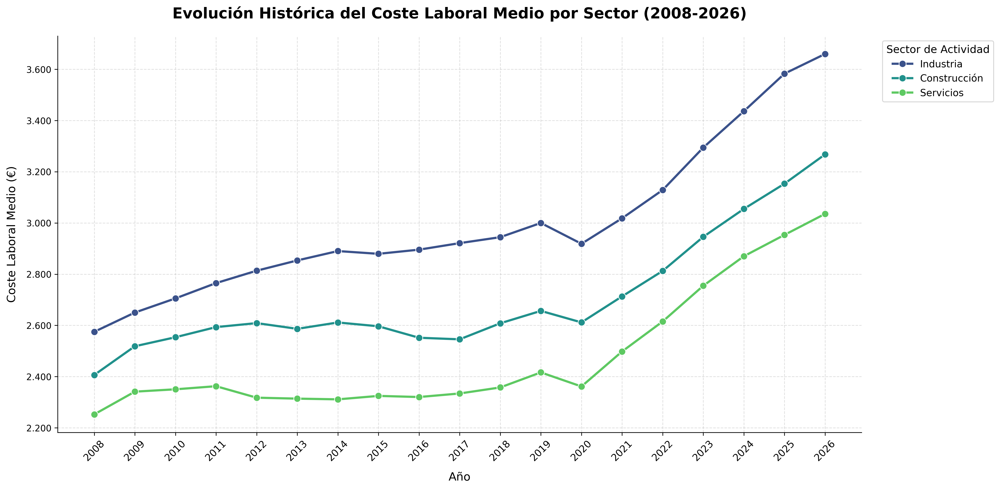
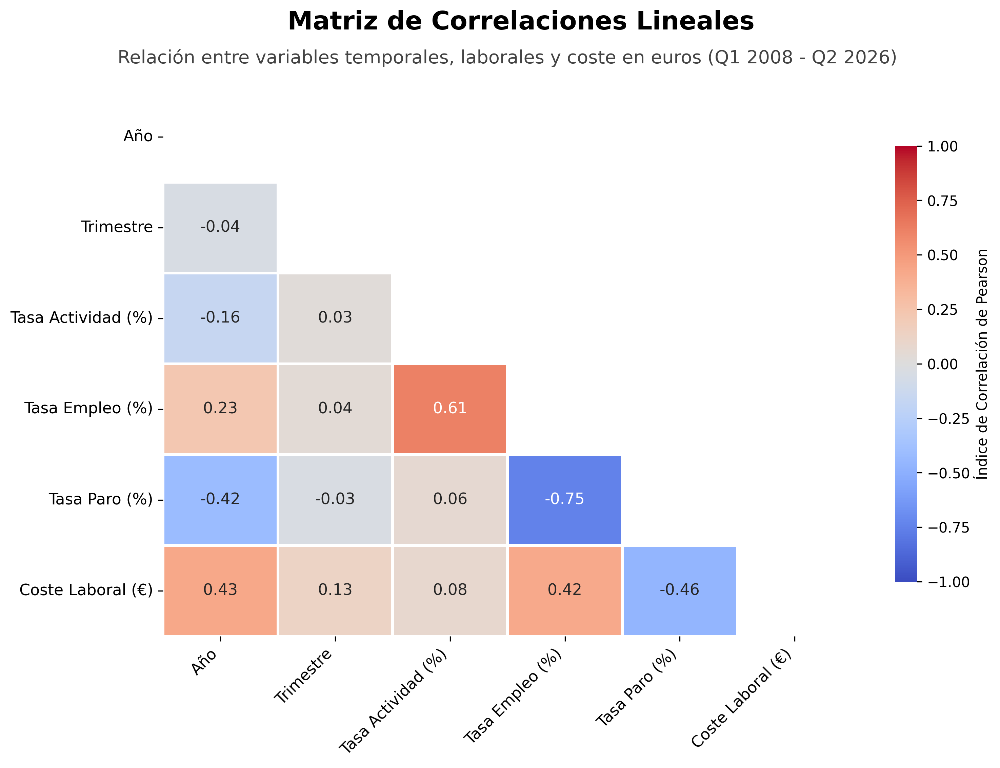
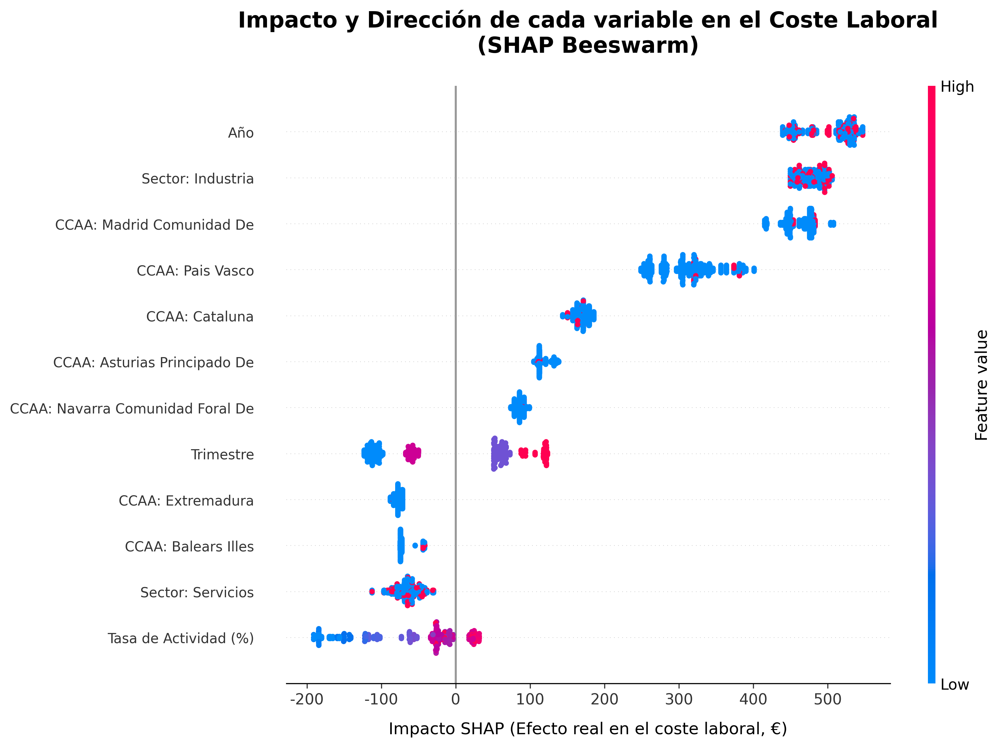
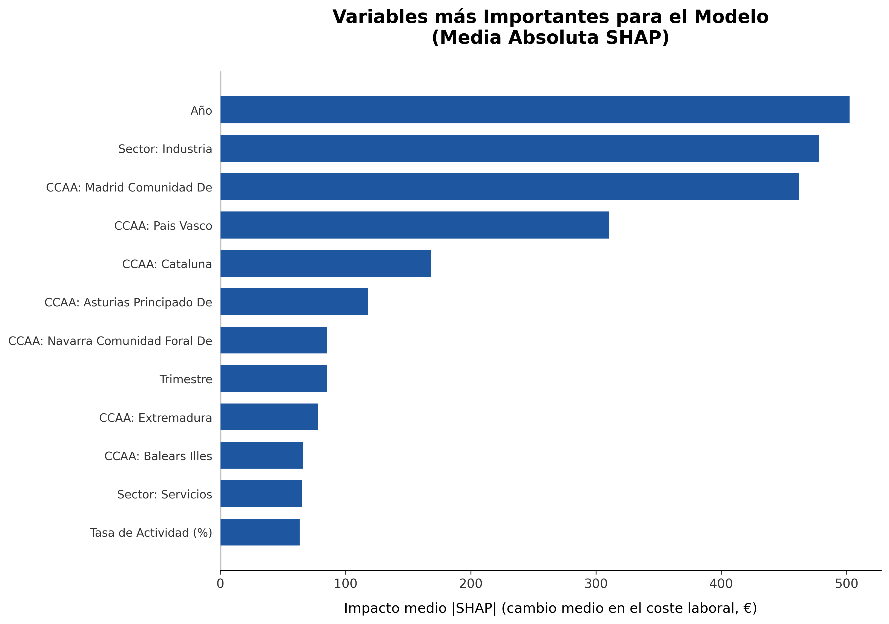
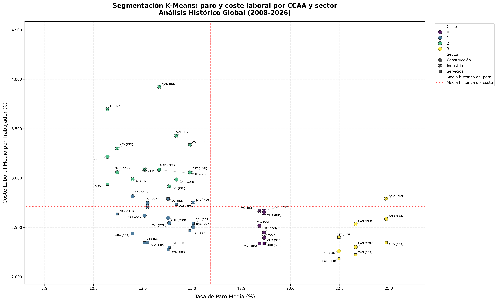
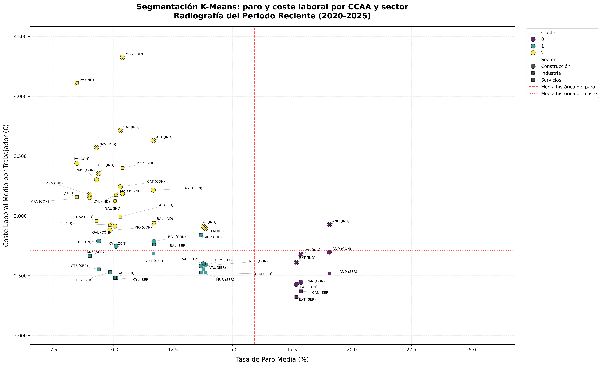
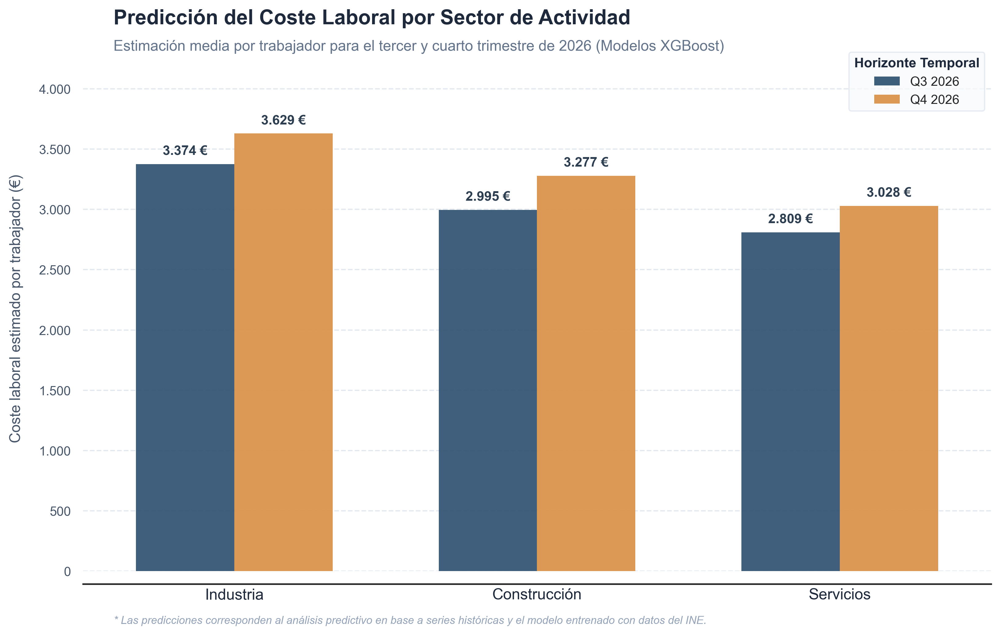

# 📊 Análisis y Predicción del Mercado Laboral en España (INE)

> **Pipeline End-to-End de datos y Machine Learning para analizar y predecir el coste laboral en España mediante SQL, XGBoost, clustering y explicabilidad con SHAP.**

## 📌 Descripción del proyecto

Este proyecto implementa un pipeline de datos y modelado predictivo a partir de información oficial del Instituto Nacional de Estadística (INE). Su objetivo es analizar la evolución del coste laboral por trabajador en España, estudiar las diferencias entre Comunidades Autónomas y sectores económicos e identificar patrones en el mercado laboral.

Se integran datos del coste laboral y de las tasas de actividad, empleo y paro de la Encuesta de Población Activa (EPA). El proceso abarca la carga, limpieza y transformación de los datos, su integración mediante MySQL, el análisis exploratorio y la aplicación de técnicas de Machine Learning.

El proyecto combina **ingeniería de datos y aprendizaje automático:** se comparan modelos de regresión para estimar el coste laboral, se aplica K-Means para identificar perfiles territoriales y se emplea SHAP para interpretar las predicciones del modelo seleccionado

**Ámbito territorial:** el análisis se limita a las 17 Comunidades Autónomas de España, ya que el conjunto de datos del coste laboral utilizado no incluye las ciudades autónomas de Ceuta y Melilla. Por coherencia metodológica, ambas ciudades también se excluyen de los datos de la EPA, de modo que las dos fuentes compartan el mismo ámbito territorial.

**Ámbito poblacional:** el estudio se realiza considerando conjuntamente a ambos sexos, utilizando la categoría `ambos_sexos` de los datos de la EPA. Por tanto, las tasas de actividad, empleo y paro, así como los análisis y modelos desarrollados, no se desglosan por sexo. El objetivo es estudiar el comportamiento general del mercado laboral en las 17 Comunidades Autónomas y sus diferencias por sector económico.

## 🛠️ Tecnologías y Herramientas

* **Lenguaje:** Python 3.x
* **Manipulación de Datos:** Pandas, NumPy y SciPy
* **Base de Datos:** MySQL / SQLAlchemy
* **Machine Learning:** Scikit-Learn, XGBoost
* **Explicabilidad (XAI):** SHAP
* **Visualización:** Matplotlib, Seaborn, AdjustText
* **Análisis estadístico**: correlaciones, distribuciones y detección de valores atípicos.

## 📁 Arquitectura del Proyecto

El código se organiza en módulos para separar la preparación de datos, el análisis exploratorio, el modelado y la visualización. También se incluyen los datos originales, el script SQL utilizado para integrar las fuentes y el archivo con las predicciones generadas.

```text
├── README.md
├── requirements.txt           # Dependencias del proyecto
├── .gitignore                 # Archivos excluidos del control de versiones
│
├── 01_data_pipeline.py        # Pipeline de extracción, transformación y carga (ETL)
├── 02_ml_pipeline.py          # Análisis, entrenamiento y generación de predicciones
├── 03_resumen_predicciones.py # Resumen de los resultados de Q3 y Q4 de 2026
│
├── data/
│   ├── Coste laboral por trabajador, comunidad autónoma, sectores de actividad.csv
│   └── Tasas de actividad, paro y empleo por provincia y sexo.csv
│
├── outputs/
│   └── predicciones_q3_q4_2026.csv  # Predicciones de coste laboral para Q3 y Q4
│
├── sql/
│   └── costes_epa_integrado.sql     # Vista SQL que integra los datos de costes y EPA
│ 
├── images/
│   ├── coste_laboral_ccaa_sector.png
│   ├── evolucion_coste_laboral.png
│   ├── correlaciones_variables.png
│   ├── shap_beeswarm.png
│   ├── shap_importancia.png
│   ├── clustering_historico.png
│   ├── clustering_reciente.png
│   └── predicciones_q3_q4_2026.png
│   
└── src/
    ├── __init__.py
    ├── database.py            # Conexión y operaciones con MySQL
    ├── data_loader.py         # Carga de los datos originales
    ├── cleaning.py            # Limpieza y transformación de datos
    ├── eda.py                 # Análisis exploratorio de datos
    ├── ml_preprocessing.py    # Preparación de variables para los modelos
    ├── ml_models.py           # Entrenamiento, evaluación y predicción
    ├── ml_clustering.py       # Segmentación mediante K-Means
    └── visualizations.py      # Gráficos y análisis SHAP
```


## 📋 Descripción de las variables

El proyecto utiliza dos conjuntos de datos del INE: uno relacionado con el coste laboral por trabajador y otro con las tasas de actividad, empleo y paro de la EPA. Tras la limpieza y transformación, ambas fuentes se integran para realizar el análisis exploratorio y preparar los datos para el modelado.

### 1. Variables del coste laboral

| Variable | Descripción |
|---|---|
| `comunidades_autonomas` | Comunidad Autónoma a la que corresponde la observación. |
| `ano` | Año de referencia del dato. |
| `trimestre` | Trimestre de referencia, del 1 al 4. |
| `sectores_actividad` | Sector económico: industria, construcción o servicios. Los datos originales también incluyen el agregado de todos los sectores. |
| `coste` | Componente del coste laboral analizado, como el coste laboral total, el coste salarial total, el coste salarial ordinario, otros costes, el coste por percepciones no salariales, las cotizaciones obligatoria o las subvenciones y bonificaciones. |
| `total` | Valor registrado para el componente del coste, expresado en euros por trabajador. |

### 2. Variables de la Encuesta de Población Activa (EPA)

| Variable | Descripción |
|---|---|
| `provincias` | Provincia a la que corresponde la observación original. |
| `comunidades_autonomas` | Comunidad Autónoma asignada a cada provincia durante el proceso de transformación. |
| `ano` | Año de referencia del dato. |
| `trimestre` | Trimestre de referencia, del 1 al 4. |
| `sexo` | Población de referencia según el sexo, incluyendo la categoría de ambos sexos. |
| `tasas` | Indicador del mercado laboral: tasa de actividad, tasa de empleo o tasa de paro. |
| `total` | Valor numérico del indicador, expresado como porcentaje. |

**Nota metodológica:** los datos originales de la EPA están desglosados por provincia. Para integrarlos con la información del coste laboral, las tasas se agrupan por Comunidad Autónoma, periodo, sexo e indicador mediante la media aritmética provincial. Por tanto, estos valores constituyen una aproximación descriptiva y no necesariamente coinciden con las tasas autonómicas oficiales publicadas por el INE.


### 3. Variables del archivo de predicciones

El archivo `outputs/predicciones_q3_q4_2026.csv` contiene las estimaciones correspondientes al tercer y cuarto trimestre de 2026. El coste laboral se estima mediante XGBoost, mientras que las tasas del mercado laboral se calculan mediante un procedimiento basado en medias históricas.

| Variable | Descripción |
|---|---|
| `ano` | Año de referencia de la estimación. |
| `trimestre` | Trimestre proyectado: Q3 (3) o Q4 (4). |
| `comunidades_autonomas` | Comunidad Autónoma a la que corresponde la estimación. |
| `sectores_actividad` | Sector económico: industria, construcción o servicios. |
| `tasa_actividad` | Tasa de actividad estimada mediante el procedimiento basado en la media histórica. |
| `tasa_empleo` | Tasa de empleo estimada mediante el procedimiento basado en la media histórica. |
| `tasa_paro` | Tasa de paro estimada mediante el procedimiento basado en la media histórica. |
| `coste_estimado_euros` | Coste laboral por trabajador estimado mediante el modelo XGBoost, expresado en euros. Es la variable objetivo del modelo supervisado. |

El archivo contiene 102 estimaciones correspondientes a 17 Comunidades Autónomas, tres sectores económicos y dos trimestres.

**Nota metodológica:** Es importante distinguir la naturaleza de las proyecciones presentadas. Mientras que el `coste_estimado_euros` es el resultado de la inferencia de nuestro modelo de Machine Learning (XGBoost), las métricas del mercado de trabajo (tasas de actividad, empleo y paro) se han calculado como variables de contexto mediante inferencia estadística basada en promedios históricos estacionales. Por tanto, los resultados deben interpretarse considerando la diferencia entre la capacidad de generalización del algoritmo no lineal y la asunción de continuidad de las tendencias macroeconómicas tradicionales.


## 🧠 Fases del Proyecto

### 1. Ingeniería de Datos y SQL (ETL)

   - Carga de los conjuntos de datos originales del INE.
   - Limpieza y normalización de nombres, categorías y variables.
   - Transformación de las fechas en variables temporales y preparación de los datos para su análisis.
   - Integración de las tablas mediante MySQL y SQLAlchemy.
   - Extracción de los datos integrados a Python y transformación al formato adecuado para el modelado.

### 2. Análisis exploratorio de datos (EDA)

Se realiza un análisis exploratorio para estudiar la evolución temporal del coste laboral, las diferencias territoriales y sectoriales, y su relación con los principales indicadores del mercado laboral.

El análisis incluye:

- **Comparación del coste laboral por Comunidad Autónoma y sector económico:** estudio de las diferencias en el coste laboral medio entre territorios y entre los sectores de industria, construcción y servicios.

- **Análisis de las subvenciones y bonificaciones:** comparación de las cuantías medias por trabajador según la Comunidad Autónoma y el sector de actividad.

- **Composición del coste laboral por sector:** análisis de los componentes principales del coste laboral, diferenciando entre el coste salarial total y otros costes laborales, como las cotizaciones y otros conceptos no salariales.

- **Distribución porcentual del coste laboral por sector:** cálculo y representación del peso porcentual del coste salarial total y de los otros costes sobre el coste laboral total, con el objetivo de comparar la estructura de costes entre los distintos sectores económicos.

- **Composición de otros costes laborales por sector:** estudio de los componentes de los otros costes laborales, considerando las cotizaciones obligatorias a la Seguridad Social, las percepciones no salariales y las subvenciones y bonificaciones de la Seguridad Social.

- **Análisis de distribuciones y valores atípicos:** identificación de observaciones extremas y evaluación de su posible relación con acontecimientos económicos relevantes.

- **Análisis de correlaciones de Pearson:** estudio de las relaciones lineales entre el coste laboral, las tasas de actividad, empleo y paro, y las variables temporales.

Los valores atípicos se mantienen cuando se consideran compatibles con observaciones económicas reales, en lugar de eliminarlos automáticamente.

### 3. Modelado predictivo supervisado

Se comparan distintos modelos de regresión para predecir el coste laboral por trabajador:

- Regresión lineal.
- Random Forest.
- XGBoost.

**XGBoost se selecciona como modelo final** por su capacidad para representar relaciones no lineales, de acuerdo con los resultados obtenidos en la evaluación.

Para respetar el orden temporal de los datos, se emplea una división basada en el tiempo (time-based split), utilizando información hasta 2024 para el entrenamiento. Asimismo, se realizan proyecciones futuras teniendo en cuenta las variaciones estacionales observadas históricamente.

### 4. Explicabilidad del modelo (SHAP)

Se utilizan valores SHAP *(SHapley Additive exPlanations)* para interpretar las predicciones de XGBoost e identificar qué variables tienen mayor influencia en las estimaciones.

Se emplean gráficos *Beeswarm* y de importancia mediante barras para analizar la contribución de las variables y comprender mejor el comportamiento del modelo.

### 5. Aprendizaje no supervisado: K-Means

Se aplica K-Means para identificar grupos de Comunidades Autónomas y sectores con características similares en términos de coste laboral y tasa de paro.

Se comparan dos periodos:

- **Histórico (2008–2026):** permite estudiar los perfiles observados a lo largo de la serie temporal.
- **Reciente (2020–2025):** permite examinar los cambios en los perfiles territoriales durante los últimos años analizados.

Esta comparación ayuda a identificar similitudes y diferencias en la evolución del mercado laboral, así como cambios en la agrupación de las regiones y los sectores.

## 📊 Visualizaciones del proyecto

### 1. Análisis exploratorio de datos (EDA)

#### Coste laboral por Comunidad Autónoma y sector

Comparación del coste laboral medio entre las 17 Comunidades Autónomas y los sectores de industria, construcción y servicios.



#### Evolución temporal del coste laboral

Análisis de la evolución del coste laboral a lo largo de la serie histórica para identificar tendencias y cambios en el mercado laboral español.



#### Matriz de correlaciones

Estudio de las relaciones lineales entre el coste laboral, las tasas de actividad, empleo y paro, y las variables temporales.



### 2. Explicabilidad del modelo XGBoost (SHAP)

#### Distribución de los valores SHAP

El gráfico *Beeswarm* permite analizar cómo influye cada variable en las predicciones del modelo, mostrando tanto la importancia de las características como el sentido de su contribución.



#### Importancia de las variables

Representación de la importancia de las variables a partir de sus valores SHAP medios absolutos, para identificar las características con mayor influencia global en las predicciones.



### 3. Aprendizaje no supervisado: K-Means

#### Clustering histórico (2008–2026)

Identificación de perfiles de Comunidades Autónomas y sectores según las características analizadas en el periodo histórico.



#### Clustering reciente (2020–2025)

Comparación de los perfiles identificados en el periodo reciente para estudiar posibles cambios en las similitudes entre territorios y sectores.



### 4. Predicciones del coste laboral para Q3 y Q4 de 2026

Comparación del coste laboral medio estimado por trabajador para los sectores de industria, construcción y servicios entre el tercer y cuarto trimestre de 2026. Los valores representan la media aritmética de las estimaciones correspondientes a las 17 Comunidades Autónomas, sin ponderación por población ocupada o número de trabajadores.




## 💡 Principales resultados e insights


### 🤖 Evaluación comparativa de los modelos predictivos

Se comparan tres modelos de regresión para estimar el coste laboral por trabajador: Regresión Lineal, Random Forest y XGBoost. La evaluación se realiza mediante tres métricas: MAE, RMSE y coeficiente de determinación (R²).

| Modelo | MAE (€) | RMSE (€) | R² |
|---|---:|---:|---:|
| **XGBoost** | **157,528** | **206,791** | **0,835** |
| Random Forest | 197,327 | 250,632 | 0,758 |
| Regresión lineal | 330,658 | 403,056 | 0,374 |

**XGBoost obtiene el mejor rendimiento de los tres modelos evaluados**, con un MAE de 157,528 €, un RMSE de 206,791 € y un R² de 0,835. Esto significa que, en el conjunto de evaluación, presenta un menor error de predicción y explica aproximadamente el 83,5 % de la variabilidad observada en la variable objetivo.

En comparación con Random Forest, XGBoost reduce el MAE aproximadamente un 20,2 % y el RMSE un 17,5 %. La diferencia es aún mayor respecto a la regresión lineal, lo que sugiere que un modelo capaz de representar relaciones no lineales se adapta mejor a los datos utilizados.

A partir de estos resultados, **se selecciona XGBoost para generar las estimaciones del coste laboral de Q3 y Q4 de 2026**.

*Nota metodológica: estos resultados corresponden al conjunto de evaluación utilizado. Su capacidad de generalización debe interpretarse teniendo en cuenta la división temporal de los datos y las limitaciones propias de las predicciones futuras.*


### 📈 Evolución del coste laboral
Entre 2008 y 2025, el coste salarial experimentó un incremento acumulado aproximado del **48 %**, según los datos analizados. La evolución temporal presenta una asociación positiva con el coste laboral, reflejando su incremento sostenido a lo largo del periodo.

Este comportamiento puede estar relacionado con diversos factores económicos, como la inflación, las actualizaciones del salario mínimo interprofesional y los cambios en la composición del empleo. El análisis observacional, por sí solo, no permite atribuir el incremento a una causa concreta.

### 🗺️ Diferencias territoriales

La Comunidad de Madrid, el País Vasco y Cataluña destacan por sus mayores niveles de coste laboral en los análisis realizados.

Estas diferencias ponen de manifiesto la heterogeneidad territorial del mercado laboral español, aunque los resultados no permiten atribuirlas a un único factor económico o social.

### 🏭 Diferencias sectoriales

La industria presenta, en los datos analizados, costes laborales medios superiores a los de los servicios y la construcción.

Este resultado evidencia la importancia de considerar el sector económico al comparar los costes laborales entre territorios


### 🔮 Predicciones del coste laboral para Q3 y Q4 de 2026

Se utiliza el modelo XGBoost seleccionado para estimar el coste laboral por trabajador durante el tercer y cuarto trimestre de 2026. El archivo `outputs/predicciones_q3_q4_2026.csv` contiene 102 estimaciones, correspondientes a 17 Comunidades Autónomas, tres sectores económicos y dos trimestres.

- **Evolución trimestral:** la media simple de las 51 combinaciones de Comunidad Autónoma y sector aumenta de 3.059,84 € en Q3 a 3.311,71 € en Q4, lo que representa un incremento estimado del 8,23 % (251,87 €). Esta media no constituye una estimación ponderada del coste laboral medio nacional.

- **Diferencias sectoriales:** la industria presenta los costes laborales medios estimados más elevados, alcanzando los 3.629,09 € en Q4. La construcción registra el mayor incremento porcentual entre ambos trimestres (+9,43 %), mientras que los servicios mantienen los niveles medios más bajos.

- **Diferencias territoriales:** el País Vasco (3.968,01 €), la Comunidad de Madrid (3.904,10 €) y Cataluña (3.715,57 €) presentan los mayores costes laborales medios estimados para Q4. Por el contrario, Extremadura registra el menor valor medio, con 2.735,04 €.

- **Variabilidad regional:** Illes Balears presenta el mayor incremento medio estimado entre Q3 y Q4 (+11,37 %), mientras que Extremadura muestra el menor (+2,68 %). Estas diferencias reflejan la heterogeneidad territorial de las proyecciones.

- **Evolución de los indicadores del mercado laboral:** además del coste laboral estimado, el archivo recoge las tasas de actividad, empleo y paro asociadas a los escenarios de Q3 y Q4. La media simple de las 17 Comunidades Autónomas muestra que la tasa de actividad pasa del 58,44 % al 58,00 %, mientras que la tasa de empleo disminuye del 53,11 % al 52,44 %. Por su parte, la tasa de paro aumenta del 9,13 % al 9,59 %. Estas variaciones muestran que el incremento estimado del coste laboral no coincide necesariamente con una mejora de los indicadores del mercado laboral.

**Limitaciones:** los valores del archivo son estimaciones generadas mediante el procedimiento de modelado y no datos oficiales observados del INE. Las variaciones descritas tienen carácter exploratorio y no permiten establecer relaciones causales. Asimismo, los indicadores de actividad, empleo y paro deben interpretarse teniendo en cuenta cómo se han obtenido los valores correspondientes a los trimestres analizados. La interpretación de las predicciones también debe considerar el rendimiento del modelo en la validación temporal y los supuestos empleados para construir las variables de los periodos proyectados.


### 🔎 Perfiles territoriales mediante K-Means

El análisis histórico identifica cuatro perfiles de agrupación, entre los que destaca un grupo de regiones como Andalucía y Extremadura, caracterizadas por tasas de paro relativamente elevadas y costes laborales más bajos.

En el periodo reciente (2020–2025), estas regiones continúan situándose en niveles de coste inferiores, mientras que sus tasas de desempleo muestran una evolución más favorable. La comparación permite estudiar cómo cambian los perfiles identificados entre ambos periodos.

### 💶 Subvenciones y bonificaciones

El análisis por trabajador y sector identifica diferencias en las subvenciones y bonificaciones de la Seguridad Social entre Comunidades Autónomas. Entre las regiones destacadas en los resultados se encuentran el País Vasco, Asturias, Aragón y Andalucía.

También se observa un máximo aproximado de **27 € por trabajador en el sector industrial en 2011**. Estos resultados describen la evolución de las cuantías registradas por trabajador, no el importe total de las ayudas recibidas por cada comunidad.


### 🔗 Relaciones entre las variables

El análisis de correlaciones de Pearson muestra las siguientes relaciones:

- **Tasa de empleo y tasa de paro:** presentan una asociación negativa marcada.
- **Tasa de actividad y tasa de empleo:** muestran una asociación positiva.
- **Coste laboral y tasa de paro:** presentan una relación negativa en el conjunto analizado.
- **Coste laboral y tasa de empleo:** muestran una relación positiva.
- **Año y coste laboral:** presentan una asociación positiva, coherente con el incremento observado a lo largo de la serie.
- **Trimestre:** muestra correlaciones lineales débiles con las variables analizadas, con un coeficiente máximo aproximado de 0,13 para el coste laboral.

Estas relaciones son descriptivas y no implican causalidad. Además, la correlación lineal débil del trimestre no descarta la existencia de patrones estacionales o relaciones no lineales, que pueden estudiarse mediante modelos predictivos.


## 🚀 Cómo ejecutar el proyecto

### 1. **Clonar el repositorio**

   ```bash
   git clone https://github.com/TuUsuario/Spain-Labor-Cost-Predictor.git
   cd Spain-Labor-Cost-Predictor
   ```
Sustituye TuUsuario por tu nombre de usuario de GitHub y comprueba que el nombre del repositorio coincide con el publicado.

### 2. Instalar las dependencias

Se recomienda crear un entorno virtual para aislar las dependencias del proyecto:

```bash
python -m venv .venv
```

**Activar el entorno virtual en Windows:**

```bash
.venv\Scripts\activate
```

**Instalar las dependencias:**

```bash
pip install -r requirements.txt
```

### 3. **Configurar MySQL**

Asegúrate de disponer de un servidor MySQL en ejecución y configura los parámetros de conexión necesarios para el proyecto.

Las credenciales deben gestionarse mediante variables de entorno o un archivo de configuración local excluido del control de versiones. **No publiques contraseñas ni credenciales de acceso en GitHub**.


### 4. Ejecutar los pipelines

Primero, ejecuta el pipeline de preparación e integración de los datos:

```bash
python 01_data_pipeline.py
```

A continuación, ejecuta el pipeline de análisis y modelado:

```bash
python 02_ml_pipeline.py
```

La ejecución requiere que los archivos de datos estén disponibles en las rutas esperadas por el proyecto y que la conexión a MySQL esté correctamente configurada.


## 👨‍💻 Autor

 **Miguel Ángel Cumplido Pavón** 
 
 [LinkedIn](https://www.linkedin.com/in/miguelángelcumplidopavón)


